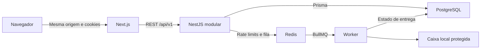

# Arquitetura

Monólito modular: web, API e worker são processos separados do mesmo produto, com uma base relacional partilhada. Não existem microserviços ou comunicação RPC entre domínios.

- `apps/web`: App Router, layouts server que validam a sessão, formulários React Hook Form e Zod, cliente API central e tipado. Estado local para mutações simples; não foi necessário TanStack Query.
- `apps/api`: NestJS, módulos por domínio, guard global, pipes Zod, filtro global e logger Pino sem dados secretos. Serviços globais partilham PostgreSQL e Redis; a autorização de organização é reutilizável.
- `apps/worker`: BullMQ, transporte exclusivamente de desenvolvimento, heartbeat Redis, reconciliação periódica de notificações PENDING e shutdown controlado.
- `packages/contracts`: schemas Zod, tipos de resposta, permissões e limites de integração futura.
- `packages/database`: Prisma, migração SQL inicial, seed e bootstrap.
- `packages/ui`: tokens centralizados em CSS, padrões shadcn com Radix/Slot/CVA, componentes comuns e primitivas acessíveis.
- `packages/config`: TypeScript strict partilhado; Turbo coordena dependências e builds.

## Decisões

Preservámos Next.js 16.4 e React 19.3 existentes. NestJS 11 CommonJS e Prisma 6.19.3 permitem usar o Node 22.14 disponível, sem migrar simultaneamente para os modelos ESM e driver adapters das versões seguintes. Todas as dependências são reproduzíveis pelo lockfile. O build web usa Webpack oficialmente suportado e Tailwind/PostCSS: a avaliação de CSS do Turbopack durante o build não conseguiu abrir uma porta interna neste ambiente; o modo de desenvolvimento mantém Turbopack. Dev e testes usam injection tokens explícitos nos construtores Nest porque o transformador TS rápido não emite design metadata.

As sessões opacas permitem revogação imediata e evitam gerir refresh/access tokens. O proxy Next mantém browser e API na mesma origem; CSRF combina validação exata de Origin com um valor aleatório associado à sessão.

As notificações funcionam como uma outbox inicial: a base guarda apenas o estado, e a fila guarda só o ID. Os links de credenciais ficam cifrados temporariamente no Redis, com TTL igual à expiração do token, nunca no PostgreSQL. Um tick do worker volta a enfileirar PENDING caso a API falhe após persistir a notificação. O ID do job e o estado SENT evitam processamento duplicado concluído. Se o Redis perder o material de entrega temporário, a notificação falha e o utilizador pode pedir um novo link; não se reconstrói um token a partir da base. O campo opcional encryptedPayload mantém-se vazio e reservado para conteúdo futuro sem credenciais, evitando uma alteração destrutiva do modelo já migrado. Não existe garantia de entrega externa exatamente uma vez; esta deverá ser tratada na integração futura.

Domínios, registradores, preços, encomendas e pagamentos têm módulos sem endpoints. Os contratos de fornecedor serão ampliados quando o caso de uso comercial for definido, evitando implementar operações fictícias.

## Fontes oficiais consultadas

- [Next.js 16](https://nextjs.org/docs/app/guides/upgrading/version-16), além dos guias de instalação e Server/Client Components presentes em `node_modules/next/dist/docs`.
- [NestJS guards](https://docs.nestjs.com/guards) e [autorização](https://docs.nestjs.com/security/authorization).
- [Prisma Migrate v6](https://www.prisma.io/docs/orm/v6/prisma-migrate/getting-started).
- [BullMQ retry e backoff](https://docs.bullmq.io/guide/retrying-failing-jobs).
- [shadcn Button / Radix](https://ui.shadcn.com/docs/components/radix/button).

## Fase 2

DomainsModule coordena catálogo ativo, normalização, AvailabilityCache e RegistrarRegistry. RegistrarsModule contém a porta interna e o adaptador Openprovider. PricingModule coordena política versionada e ExchangeRateProvider manual. CatalogModule fornece administração auditada. CartModule mantém identidade/persistência e revalida através de DomainsModule; AuthModule associa o carrinho após login. Os módulos continuam no mesmo NestJS, sem microserviços. O worker existente acrescenta manutenção de retenção. Nenhum provider fictício integra o runtime da aplicação.

## Comércio na Fase 3

O monólito modular mantém API REST e worker separado. `packages/commerce` contém estados, contratos de gateways, processamento idempotente, outbox e documentos. `packages/registrars` contém transporte/cache de autenticação partilhados com o worker; os ficheiros Nest existentes mantêm fachadas com DI. Não foram introduzidos microserviços. O módulo Commerce fornece serviços de autorização, checkout, pagamentos, reembolsos e documentos aos controllers de cada domínio.

Intenções são persistidas antes de efeitos externos. Jobs são repetíveis e resultados incertos exigem consulta ao fornecedor. As barreiras de ambiente são verificadas no backend e no transporte de escrita; credenciais isoladamente não permitem uma compra.
